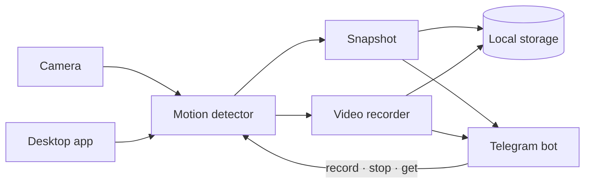

<p align="center">
  
</p>

<h1 align="center">SpareEye</h1>

<p align="center">
  Turn a spare computer into a private, subscription-free security camera.
</p>

SpareEye watches a camera for movement, saves the evidence locally, and sends
alerts to your phone through your own Telegram bot. Arm it from the desktop app
or run it headlessly on a machine tucked out of sight.

> [!IMPORTANT]
> Telegram alerts upload clips and snapshots to Telegram's servers. Read the
> [privacy and security guide](docs/SECURITY.md) before recording a shared
> space.

## Features

- Motion-triggered snapshots and video clips
- Instant alerts through your own Telegram bot
- Remote recording and retrieval with Telegram commands
- Automatic day and night sensitivity profiles
- Local recording browser and configurable retention
- Built-in, USB, and other connected camera support
- Desktop app for Windows and Linux
- Headless CLI for machines without a display

## How it works



Motion is detected and recorded locally. Only alerts are sent through Telegram;
SpareEye has no cloud account or subscription of its own. See
[Architecture](docs/ARCHITECTURE.md) for the package design and data flow.

## Quick start

### 1. Install SpareEye

Download a Windows or Linux package from the
[latest release](https://github.com/issar13/spare-eye/releases/latest).

Building from source instead? Follow the
[development guide](docs/DEVELOPMENT.md).

### 2. Create a Telegram bot

Create your own bot with BotFather, start a chat with it, then paste its token
into SpareEye. The [Telegram setup guide](docs/SETUP-TELEGRAM.md) walks through
the five-minute process.

### 3. Choose a camera and arm it

Open **Setup**, connect Telegram, choose one of the detected cameras, and press
**Start watching**.

That is all the desktop app requires. To run from source without a window:

```bash
export TELEGRAM_BOT_TOKEN=...
export TELEGRAM_CHAT_ID=...
make cameras
make run
```

The CLI reads `config.json` first and uses those environment variables as a
fallback. Run `make help` to see every available command.

## Control it from Telegram

Only the chat connected during setup can control SpareEye.

| Command | Action |
|---|---|
| `/record` | Start a manual recording |
| `/stop` | Stop the manual recording |
| `/get` | List saved clips; reply with a number to receive one |

The leading slash is optional, and `list` is an alias for `get`.

## Platforms

| Platform | Status |
|---|---|
| Windows | Supported; release binaries are currently unsigned |
| Linux | Supported |
| macOS | Not currently supported |

For source-build dependencies, OpenCV compatibility, and platform-specific
notes, see [Development](docs/DEVELOPMENT.md).

## Documentation

| Guide | What it covers |
|---|---|
| [Telegram setup](docs/SETUP-TELEGRAM.md) | Create a bot and connect it safely |
| [Configuration](docs/CONFIGURATION.md) | Detection, schedules, storage, and startup |
| [Troubleshooting](docs/TROUBLESHOOTING.md) | Camera, startup, encoding, and Linux issues |
| [Privacy and security](docs/SECURITY.md) | Footage, credentials, storage, and consent |
| [Architecture](docs/ARCHITECTURE.md) | Packages, data flow, concurrency, and extension points |
| [Development](docs/DEVELOPMENT.md) | Toolchains, builds, tests, CI, and releases |
| [FAQ](docs/FAQ.md) | Platform and design decisions |

## Contributing

Bug reports and pull requests are welcome. Start with
[Development](docs/DEVELOPMENT.md) for the supported toolchains and test
commands, and read [Architecture](docs/ARCHITECTURE.md) before changing package
boundaries.

## License

[MIT](LICENSE)
